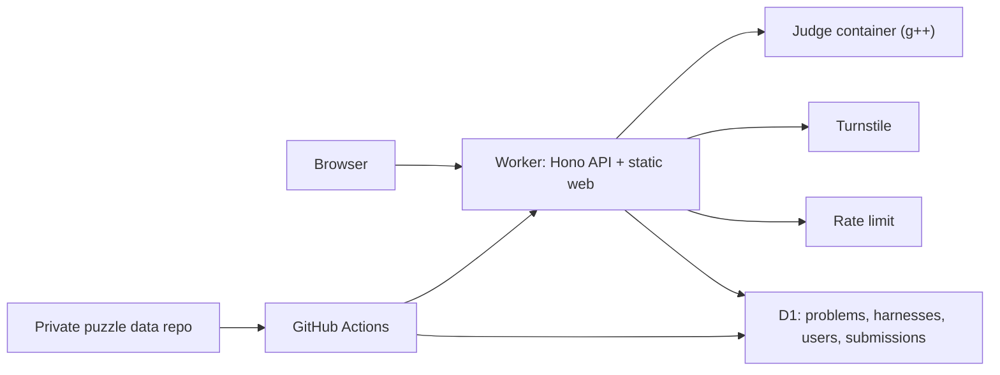

<div align="center">
  <a href="https://cpp-trap.kim1109123.workers.dev">
    <picture>
      <source media="(prefers-color-scheme: dark)" srcset=".github/images/logo-dark.svg">
      <source media="(prefers-color-scheme: light)" srcset=".github/images/logo-light.svg">
      
    </picture>
  </a>
</div>

<div align="center">
  <h3>Tiny C++ puzzles about the language's traps.</h3>
</div>

<div align="center">
  <a href="LICENSE"></a>
  <a href="https://github.com/amsminn/cpp-trap/actions/workflows/deploy.yml"></a>
  <a href="https://cpp-trap.kim1109123.workers.dev"></a>
  
</div>

<br>

C++ Trap is a web judge for the 14 C++ Trap puzzles by Mawekl, first published on Security Traps (securitytraps.pl). Every puzzle gives you a small C++ program with one empty slot. Fill the slot within tight limits (a character budget, banned tokens, a semicolon cap) so that the program reaches its goal, usually calling `victory()`. Submissions compile with a pinned GCC 4.9 in strict C++11 mode, the closest match to the original site's judge, and run in a sandboxed container on Cloudflare.

> [!TIP]
> Just want to play? Open **[cpp-trap.kim1109123.workers.dev](https://cpp-trap.kim1109123.workers.dev)**. Problems are readable without an account; sign in with GitHub to submit.

## Quickstart

Run the web app against its built-in mock API. No accounts, Cloudflare resources or puzzle data are needed:

```bash
git clone https://github.com/amsminn/cpp-trap.git
cd cpp-trap
pnpm install --frozen-lockfile
VITE_MOCK=1 pnpm --filter @cpp-trap/web dev
```

Open the URL Vite prints (http://localhost:5173 by default). The mock serves four sample problems and accepts demo inputs, so you can work on the UI without a judge.

> [!NOTE]
> Reference solutions and the hidden harnesses of some puzzles live in a separate private repository, so the real-judge test suite and problem sync only run for maintainers. Please do not post solutions in issues or pull requests.

To run the full stack (Worker, D1 and the judge container) you need Node 22+, pnpm 12.14.0, Docker, and a problems directory:

```bash
cp .dev.vars.example .dev.vars          # local OAuth app + session pepper; Turnstile test keys included
pnpm exec wrangler d1 migrations apply cpp-trap --local
pnpm --filter @cpp-trap/scripts exec tsx sync-problems.ts <problems-dir> --local
pnpm --filter @cpp-trap/web exec vite build --mode qa   # Turnstile test site key instead of production
pnpm exec wrangler dev --local          # http://localhost:8787
```

## Why C++ Trap?

- **A real judge, not a regex** — code is compiled with a pinned `g++` 4.9.4 (`-std=c++11 -O0`, no stack protector) on x86-64 glibc and executed, because several puzzles depend on the exact compiler, standard mode and ABI. Trigraphs work, as they did on the original site.
- **A sandbox you can read** — a dedicated runner uid, `prlimit` caps, `setpriv` without capabilities, `bwrap` namespaces when available, no shell in the image and no network in the container ([`judge/README.md`](judge/README.md)).
- **Victory you cannot fake** — the program must write a fresh 32-byte token to fd 3 from a separately compiled object; printing "victory" or exiting 0 does nothing.
- **One set of rules everywhere** — the browser and the API validate input with the same code in `shared/`, so what the editor accepts is exactly what the judge accepts.
- **Built to be shared** — per-problem leaderboards for shortest accepted code, solutions unlocked only after you solve, and server-rendered pages that search engines and AI crawlers can read.
- **Small to run** — one Cloudflare Worker, one D1 database and one basic container instance with daily quotas and a per-user rate limit.

## Architecture



| Path | What lives there |
| --- | --- |
| [`shared/`](shared) | API contracts and the input rules (`shared/src/rules.ts`) |
| [`api/`](api) | Worker: routes, GitHub OAuth, D1, submit flow (`api/src/submit.ts`), crawlable pages (`api/src/seo.ts`) |
| [`web/`](web) | React SPA; design tokens in `web/src/styles.css` |
| [`judge/`](judge) | Pinned compiler image and sandbox (`judge/src/run.ts`) |
| [`e2e/`](e2e) | Real-judge reference and forgery probes |
| [`scripts/`](scripts) | Problem validation and D1 sync |
| [`docs/operations.md`](docs/operations.md) | Deploy, configuration, limits, kill switches and secret rotation |

## Development

Three kinds of tests are maintained:

```bash
pnpm -r typecheck
pnpm test                                                        # shared input-rule unit tests
pnpm --filter @cpp-trap/scripts exec tsx validate-problems.ts <problems-dir>
PROBLEMS_DIR=<problems-dir> JUDGE_URL=http://localhost:8080 pnpm e2e   # real judge, see judge/README.md
```

Routes, OAuth and UI changes get manual QA in a browser at desktop and phone widths.

## Contributing

Issues and pull requests are welcome: UI and accessibility fixes, judge hardening, docs. Pull requests from forks run typecheck, unit tests and the judge image build; the native compatibility gate needs the private puzzle data and runs after a maintainer merges. Keep changes small and focused, and never include puzzle solutions.

## Resources

- **[Play C++ Trap](https://cpp-trap.kim1109123.workers.dev)** — the live site
- **[Judge environment](judge/README.md)** — compiler pins, flags and resource limits
- **[Operations](docs/operations.md)** — deploying your own instance on Cloudflare

## License

The code is released under the [MIT License](LICENSE). The puzzles are by **Mawekl** and are credited on every problem page; this project is not affiliated with the author or Security Traps. Rights holders who want a puzzle corrected or removed can [contact the maintainer](https://github.com/amsminn), and it will be taken down on request.
